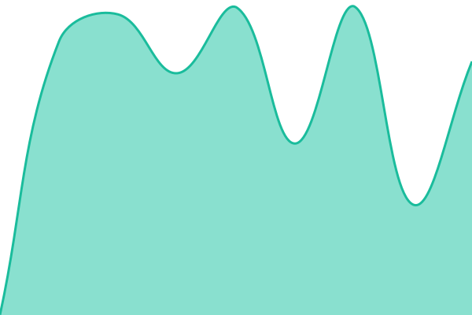

# [📈 Live Status](https://comnstudio.github.io/status): <!--live status--> **🟩 All systems operational**

This repository contains the open-source uptime monitor and status page for [ComnStudio](https://comnstudio.com/), powered by [Upptime](https://github.com/upptime/upptime).

With [Upptime](https://upptime.js.org), you can get your own unlimited and free uptime monitor and status page, powered entirely by a GitHub repository. We use [Issues](https://github.com/comnstudio/status/issues) as incident reports, [Actions](https://github.com/comnstudio/status/actions) as uptime monitors, and [Pages](https://comnstudio.github.io/status) for the status page.

<!--start: status pages-->
<!-- This summary is generated by Upptime (https://github.com/upptime/upptime) -->
<!-- Do not edit this manually, your changes will be overwritten -->
<!-- prettier-ignore -->
| URL | Status | History | Response Time | Uptime |
| --- | ------ | ------- | ------------- | ------ |
|  [Website](https://comn.click/) | 🟩 Up | [website.yml](https://github.com/comnstudio/status/commits/HEAD/history/website.yml) | 

 1143ms
     
 | 

<a href="https://status.comn.click/history/website">100.00%</a>
    

|  [Dashboard login](https://comn.click/editor/) | 🟩 Up | [dashboard-login.yml](https://github.com/comnstudio/status/commits/HEAD/history/dashboard-login.yml) | 

 968ms
     
 | 

<a href="https://status.comn.click/history/dashboard-login">100.00%</a>
    

|  [Client page demo](https://comn.click/bloom-salon-demo/) | 🟩 Up | [client-page-demo.yml](https://github.com/comnstudio/status/commits/HEAD/history/client-page-demo.yml) | 

 1082ms
     
 | 

<a href="https://status.comn.click/history/client-page-demo">100.00%</a>
    

|  [City directory](https://comn.click/directory/) | 🟩 Up | [city-directory.yml](https://github.com/comnstudio/status/commits/HEAD/history/city-directory.yml) | 

 996ms
     
 | 

<a href="https://status.comn.click/history/city-directory">100.00%</a>
    

|  [Help site](https://help.comn.click/) | 🟩 Up | [help-site.yml](https://github.com/comnstudio/status/commits/HEAD/history/help-site.yml) | 

 931ms
     
 | 

<a href="https://status.comn.click/history/help-site">94.31%</a>
    

|  [App and server health](https://comn.click/health.php) | 🟩 Up | [app-and-server-health.yml](https://github.com/comnstudio/status/commits/HEAD/history/app-and-server-health.yml) | 

 686ms
     
 | 

<a href="https://status.comn.click/history/app-and-server-health">100.00%</a>
    

|  [Telegram bot](https://bot.comn.click/health) | 🟩 Up | [telegram-bot.yml](https://github.com/comnstudio/status/commits/HEAD/history/telegram-bot.yml) | 

 702ms
     
 | 

<a href="https://status.comn.click/history/telegram-bot">94.41%</a>
    

<!--end: status pages-->

[**Visit our status website →**](https://comnstudio.github.io/status)

## 📄 License

- Powered by: [Upptime](https://github.com/upptime/upptime)
- Code: [MIT](./LICENSE) © [Anand Chowdhary](https://anandchowdhary.com)
- Data in the `./history` directory: [Open Database License](https://opendatacommons.org/licenses/odbl/1-0/)
